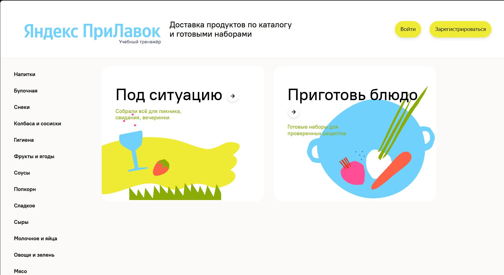

# Яндекс Прилавок — итоговая работа по ручному тестированию

Учебный QA-проект: тестирование регистрации и авторизации веб-приложения «Яндекс Прилавок», API, сохранения данных в БД и Android-приложения YandexPrilavok_1.0.0.

Автор: Иванов В. А. Дата итогового отчёта: 25.10.2026.

## Стенд и мобильное приложение

Во время выполнения работы сервер учебного стенда был реально запущен, а проверки проводились на работающем приложении. Постоянная ссылка на стенд не публикуется: без запущенного сервера она не будет работать. Скриншот выше показывает интерфейс использованного стенда.

- [Скачать Android-приложение YandexPrilavok_1.0.0.apk](https://code.s3.yandex.net/qa-manual/apk/YandexPrilavok_1.0.0.apk?etag=1a980ef776aea7bb4bbe9e44f3f04c48)
- [Макеты интерфейса в Figma](https://www.figma.com/design/CLHnTSsOLTJiSJQl7TUNnd/Prilavok?node-id=0-1)
- [Скачать книгу с тестовой документацией и результатами](Prilavok_QA.xlsx)

## Что было проделано

1. Выделены объекты тестирования: поля регистрации, кнопки, ссылки, сообщения, формы регистрации и входа.
2. Проанализированы неоднозначности требований. Сформулированы вопросы и рабочие допущения по форматам полей, обязательности, нормализации, сообщениям об ошибках и состояниям интерфейса.
3. Подготовлены классы эквивалентности и граничные значения с примерами тестовых данных для проверки полей.
4. Составлен и выполнен смоук-чек-лист из 7 проверок.
5. Проведены функциональные проверки регистрации и авторизации, позитивные и негативные сценарии, проверки обязательности полей и соответствия интерфейса требованиям. Результаты зафиксированы в матрице окружений.
6. Проверены запросы `POST /api/v1/users` и `POST /api/v1/users/login`, коды ответов, выдача токена и сохранение либо отсутствие данных в БД. В книге отдельно записаны проверки через API, UI/DevTools и БД.
7. Выполнены 9 мобильных сценариев: установка и запуск APK, главный экран, поворот, возврат из фона, входящий звонок и SMS, режим полёта и потеря сети.
8. Оформлены 12 баг-репортов с шагами, ожидаемым и фактическим результатами, окружением, серьёзностью, приоритетом и ссылками на доказательства.
9. Подготовлен итоговый вывод о готовности к релизу.

## Результаты из тестовой документации

| Набор проверок | Passed | Failed | Blocked | Skipped | Выполнено: Passed + Failed |
|---|---:|---:|---:|---:|---:|
| Основной чек-лист: веб, API и БД | 64 | 34 | 8 | 49 | 98 |
| Смоук | 5 | 2 | 0 | 0 | 7 |
| Мобильные сценарии | 8 | 1 | 0 | 0 | 9 |

В основном чек-листе 155 записей статусов: 98 выполненных, 8 заблокированных и 49 пропущенных. Считается каждая заполненная ячейка статуса, включая отдельные шаги API/БД и окружения. Это не число уникальных тест-кейсов. Пустые ячейки не считаются пройденными или пропущенными. Смоук и мобильные сценарии представлены отдельно: их нельзя прибавлять к числу уникальных сценариев без учёта пересечений.

Результаты отражают записи завершённой работы. При подготовке репозитория выполнена проверка документации и арифметики, а не новый прогон приложения.

### Окружения

- Основная веб-матрица: Chrome 1920×1080, Firefox 1280×720, Chrome 768×1024. Статусы каждого окружения приведены в книге; наличие колонки не означает полный прогон.
- Смоук: Opera 1920×1080, согласно записям от 20.10.2026.
- Мобильные проверки: Android Emulator, Android 15, API 35.
- Версия веб-приложения в шаблоне отчёта: 2.0.1. Версия APK: 1.0.0.

### Найденные дефекты

| Severity | Количество |
|---|---:|
| Critical | 1 |
| Major | 6 |
| Minor | 5 |
| Всего | 12 |

Ключевые проблемы: аварийное завершение приложения при повороте экрана (`bug-11`), создание аккаунта без обязательного телефона (`bug-2`), перекрытие полей регистрации содержимым главной (`bug-10`), нарушения поведения попапа и обязательных полей, отсутствие перехода ко входу из футера.

**Вывод по записанным результатам: к релизу не готово.** Требуются исправления, повторная проверка дефектов, регресс и смоук. Рабочие допущения в анализе требований требуют согласования.

## Состав книги

| Лист | Содержание |
|---|---|
| Объекты и серые зоны | Объекты, вопросы к требованиям и допущения |
| Чек-лист смоук | Базовые проверки работоспособности |
| Чек-лист | Функциональные проверки, API/БД, статусы и связи с дефектами |
| Баг-репорты | 12 дефектов и ссылки на доказательства |
| КЭ и ГЗ | Классы эквивалентности, границы и тестовые данные |
| Мобильное тестирование | 9 сценариев для Android |
| Итоговая сводка и готовность | Подсчёты и вывод о релизе |

## Проверка перед публикацией

- Убран красный цвет шрифта в 387 ячейках, а также в правилах условного форматирования. Цветовые заливки и текст результатов сохранены.
- Исправлен двойной подсчёт статусов: Excel `COUNTIF` не различает регистр, поэтому складывать результаты для `PASSED` и `Passed` нельзя.
- Восстановлены заголовки `E63:G63` основного чек-листа: вместо названий окружений там находились `SKIPPED`, `PASSED`, `PASSED`, ошибочно попадавшие в итог.
- Из количества выполненных прогонов исключены `Blocked`. Выполненные проверки считаются как `Passed + Failed`.
- Сводка сверена с отдельным подсчётом записей. Сохранены семь листов, исходные результаты тестирования и ссылки на доказательства.

Открывайте XLSX в Excel или другом совместимом редакторе. Ссылки на доказательства находятся в баг-репортах; их доступность зависит от разрешений владельца Google Drive. Исходный код приложения и APK не включены в репозиторий; для APK дана ссылка на источник.
